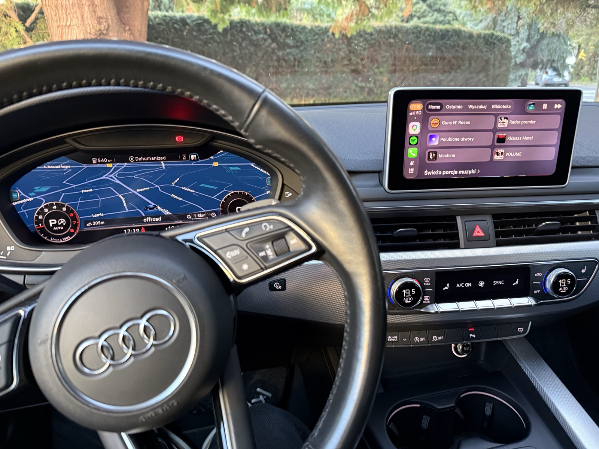

# mib2q-carplay

CarPlay and Android Auto on the Audi Virtual Cockpit for **MHI2Q** head units:
turn-by-turn guidance on the cluster and HUD, cover art, and the phone's own map video
on the cluster (CarPlay AltScreen and the Android Auto cluster display).



> [!WARNING]
> This modifies firmware processes and system configuration on your head unit.
> Use it only on a unit you own, back up every file you change, and accept that
> you do it at your own risk.

## Contents

- [Features](#features)
- [Supported units](#supported-units)
- [Tested wireless adapters](#tested-wireless-adapters)
- [Requirements](#requirements)
- [Build](#build)
- [Install](#install)
- [Logs and diagnostics](#logs-and-diagnostics)
- [Tests](#tests)
- [Repository layout](#repository-layout)
- [TODO](#todo)
- [Credits](#credits)
- [License](#license)

## Features

The base install needs no settings. Plug in the phone and the cluster features follow
CarPlay or Android Auto automatically.

- **Turn-by-turn on the cluster.** A 3D maneuver arrow is drawn over the stock cluster
  map, with lane arrows, distance to the turn, arrival time and remaining distance.
  This needs a navigation app that sends CarPlay route guidance: Apple Maps and Google
  Maps do, but Waze does not.
- **Route text in the Virtual Cockpit.** Shows the next road or exit sign. Press **OK**
  on the steering wheel to toggle arrival time and time left.
- **Head-up display.** The same maneuver icons, lanes and distance.
- **CarPlay calls on the cluster phone tab.** Caller, call state and timer, accept / hang up,
  hold, mute and dialling (tab or steering wheel), recents, favorites, missed calls, signal
  and carrier, instead of the stock "Your iPhone is in Apple CarPlay mode" note. The HU phone
  app goes straight to CarPlay. See [`docs/hook/phone-and-vehicle.md`](docs/hook/phone-and-vehicle.md).
- **Car data to the iPhone.** Wheel speed, range, outside temperature and the low-fuel warning,
  for apps that use them. Set the engine type with one word (`gasoline`, `diesel`, `electric`,
  `cng`) in `/mnt/app/root/carplay_vehicle_engine` (default gasoline).
- **Siri on a short press (opt-in).** The steering-wheel voice key opens Siri on a short press
  too while CarPlay is connected (menu: *Siri on short voice-key press*); off by default.
- **Cover art** on the cluster media screen.
- **Parking popups no longer hide CarPlay** (front PDC view).
- **MMI touchpad → D-pad** so drags navigate CarPlay menus (can be switched off: then
  the touchpad goes to CarPlay the stock way).
- **AltScreen (optional, experimental).** The CarPlay map video on the cluster. With an
  app that sends route guidance the cluster draws the maneuver itself and the phone streams
  the bare map; with Waze the phone draws its own turn card and ETA into the cluster map.
  Status and open issues are in
  [`docs/deploy/altscreen-mhi2q.md`](docs/deploy/altscreen-mhi2q.md).
- **Android Auto.** The Google Maps / Waze map video on the cluster (following the Large,
  Classic and Sport cockpit layouts), the same turn arrow, distance, lanes, route text and
  HUD as CarPlay, and Android Auto cover art. Tested on the car; the steering-wheel roller
  does not zoom the Android Auto map (Android Auto has no zoom command for it). The cluster
  map needs a receiver profile for the unit's `gal` (MU0918 and MU1329 are built in). See
  [`docs/android-auto/overview.md`](docs/android-auto/overview.md).

**Compatibility:** Audi MHI2Q units with a fully digital cluster (Virtual Cockpit).
Developed and tested on an **Audi A5 (F5) with MU1329** (`MHI2Q_ER_AUG22_P5152`) firmware. Other MHI2Q
firmware and cluster layouts are untested; the Java patch is always built against
your own unit's HMI (see [Build](#build)), but cluster geometry may need calibration.

## Supported units

Units the mod has been run on. Other MHI2Q firmware may work too; the Java patch is
built against your own unit's HMI, but cluster geometry may need calibration.

| Firmware train | Vehicle | Notes |
| --- | --- | --- |
| `MHI2Q_ER_AUG22_P5152` | Audi A5 (F5), MU1329 | development unit; all features tested |
| `MHI2Q_ER_AUG22_P5092` | MU1329 | wireless CarPlay tested, [report](https://github.com/kamgurgul/mib2q-carplay/issues/5) |
| `MHI2Q_US_AUG22_P5087` | Audi A5 Sportback (B9, US, 2018), MU1316 | release 1.1, wired CarPlay, Apple Maps on the Virtual Cockpit, [report](https://github.com/kamgurgul/mib2q-carplay/issues/21) |

## Tested wireless adapters

Adapters that put the phone's map on the Virtual Cockpit. A USB cable still works
without any of these.

| Adapter | Version | Startup | Cluster map |
| --- | --- | --- | --- |
| Baseus Safe Journey Series Wireless CarPlay Adapter | build `26031311.2705.1` | fast | yes, no custom firmware, [report](https://github.com/kamgurgul/mib2q-carplay/issues/5) |
| Carlinkit 5.0 / 2Air | software `2025.12.29.1746`, hardware `U2AC822C0` | slow, then stable | yes, no custom firmware, [report](https://github.com/kamgurgul/mib2q-carplay/issues/5) |
| HW301 (Allwinner, setup Wi-Fi `smartBox`, web UI `192.168.5.1`) | custom app image **v1162** (`v1162-20261020152434`) | same as stock HW301 | yes, **from release 1.3**, only with that image plus the 1.3 head-unit install. Stock v1.26 / v1.29 stay on the main screen. [How to flash](docs/deploy/hw301-dongle.md) |

An HW301 on stock firmware tells the head unit it is an iPhone 7 (`iPhone9,1` / `18D70`)
and never opens the cluster stream, so the cockpit keeps the Audi map. The v1162 image
keeps that main screen and adds the cluster stream; it needs mib2q-carplay **1.3** or newer
on the head unit. Other `smartBox-xxxx` boards are not this image; do not flash
`hw301_v1162.tar` onto them.

## Requirements

**On the build machine:**

| What | Why |
| --- | --- |
| Docker with `linux/amd64` support (Docker Desktop on macOS/Windows) | every artifact cross-compiles in a container; no host QNX SDP or JDK is needed to build |
| The `qnx65-armv7-toolchain` image (step 1) | GCC 8.5 for QNX 6.5 ARMv7, used by the native builds |
| Network access on the first build | the image fetches GCC/binutils sources; the AltScreen renderer fetches FFmpeg 6.1.5; `eclipse-temurin:8` is pulled for Java |
| Your unit's `lsd.jxe`, converted to a jar (step 2) | the Java patch compiles against the stock HMI classes |
| ~3 GB disk | toolchain image, Java image, `stock/` |

On Windows, run everything from **WSL** in a Linux path (`~/…`), not `/mnt/c`, and
not from Git Bash.

**On the car:** an MHI2Q unit with M.I.B. (More Incredible Bash) on an SD card, or a
root shell over SSH/Telnet.

## Build

### 1. Toolchain image (once)

```sh
git clone https://github.com/luka-dev/qnx65-armv7-toolchain
cd qnx65-armv7-toolchain
git config core.symlinks    # must not print "false"
docker build --platform=linux/amd64 --target base-env --build-arg BASE=base-8.5 \
    -t qnx65-armv7-toolchain:latest .
```

The image's QNX SDP contains about 150 symlinks. A checkout where they became plain
text files (`core.symlinks=false`, a Windows clone, a zip or a copied folder) fails
late, in `ar`, while linking libgcc. Clone it fresh if that happens. The first build
takes 30–60 minutes, longer on Apple Silicon under emulation.

### 2. Stock HMI jar → `stock/`

The Java patch compiles against your firmware's own classes (`de.audi.*`,
`de.esolutions.*`, `org.dsi.*`). These cannot be downloaded, so take them from your car:

1. Copy `lsd.jxe` off the unit into `stock/jxe/`. Either run
   `mods/extract_lsd_MoreIncredibleBash/` from M.I.B. (it only reads), or use SSH:
   ```sh
   scp root@<unit>:/mnt/app/eso/hmi/lsd/lsd.jxe stock/jxe/
   ```
2. Convert it with [jxe2jar](https://github.com/luka-dev/jxe2jar). The tool lives
   outside this repo and is not needed again afterwards:
   ```sh
   python3 src/jxe2jar.py /path/to/stock/jxe/lsd.jxe /path/to/stock/base.jar
   ```
3. Put the two public OSGi jars in `stock/libs/` (`org.osgi.framework-1.10.0.jar`,
   `org.osgi.util.tracker-1.5.4.jar`, both on Maven Central).

`stock/` is gitignored because it holds proprietary firmware code. The full layout,
including the optional test JDK, is in [`stock/README.md`](stock/README.md).

### 3. Build everything and stage the SD card

From the repository root:

```sh
./scripts/build_all.sh                  # base + AltScreen + Android Auto map
ALTSCREEN=0 ./scripts/build_all.sh      # no cluster video renderer / CarPlay video hook
ANDROID_AUTO=0 ./scripts/build_all.sh   # no gal launcher / Android Auto cluster hook
```

This runs every build below in order, then replaces
`mods/install_MoreIncredibleBash/mod/carplay/` with exactly one complete release. Copy
`mods/install_MoreIncredibleBash/` to the SD card and go to [Install](#install).

The individual builds write to `build/`:

```sh
./scripts/build_hook.sh                 # → build/libcarplay_hook.so
./scripts/build_renderers.sh            # → build/maneuver_render
./scripts/build_java.sh                 # → build/carplay_hook.jar
# optional: AltScreen (CarPlay map video on the cluster)
bash scripts/build_altscreen_render.sh  # → build/altscreen_render
./scripts/build_altscreen_hook.sh       # → build/libaltscreen111_mhi2q.so
# optional: Android Auto map video on the cluster (also needs altscreen_render)
./scripts/build_aa_hook.sh              # → build/libaa_cluster_hook.so
```

| Artifact | Runs as | Needed for |
| --- | --- | --- |
| `libcarplay_hook.so` | `LD_PRELOAD` in `dio_manager` | everything (route guidance, cover art) |
| `maneuver_render` | cluster overlay process | maneuver arrow on the cluster |
| `carplay_hook.jar` | on the HMI's J9 boot classpath | cluster/HUD/BAP bridge, PDC, touchpad |
| `altscreen_render` | cluster video process | AltScreen only |
| `libaltscreen111_mhi2q.so` | second `LD_PRELOAD` in `dio_manager` | AltScreen only |
| `libaa_cluster_hook.so` + `aa_startup.sh` | `LD_PRELOAD` in `gal` / its SI launcher | Android Auto map video only |

Optional switches:

- `LOG_RGD_PACKET_RAW=1 ./scripts/build_hook.sh` adds raw route-guidance packet dumps.
- `STOCK_JAR=<path inside stock/> ./scripts/build_java.sh` builds against a different
  jar.

To stage by hand instead, copy the five `build/` outputs, plus
`maneuver_render/resources/flag_atlas.rgba` and the four `carplay_*.sh` and
`carplay_child.json` from `deploy/smartphone_integrator/`, into
`mods/install_MoreIncredibleBash/mod/carplay/`. The installer stops before writing
anything if one of the eight base files is missing. The AltScreen pair, the Android Auto
files (`libaa_cluster_hook.so`, `aa_startup.sh`, `aa_child.json`) and
`carplay_child.json` are picked up when present; with the Android Auto files the `gal`
child of `smartphone_integrator.json` is replaced too.

## Install

**With M.I.B. (recommended):**

1. Copy `mods/install_MoreIncredibleBash/` to the M.I.B. SD card.
2. Disconnect CarPlay.
3. Run **GEM → M.I.B. → Advanced Settings → Run Custom Script**.

The installer:
- copies the release into `/mnt/app/root/hooks/` and `/mnt/app/eso/hmi/lsd/jars/`;
- patches `smartphone_integrator.json` and `dio_manager.json` in place, keeping a
  `.carplay-stock` backup of each;
- never reboots or stops processes.

`mods/uninstall_MoreIncredibleBash/` reverts everything.

**Reboot:** disconnect CarPlay, run `sync`, wait a few seconds, then reboot normally.
Don't use the forced MMI button combo right after copying, because it can leave files
truncated. The jar only loads after a full restart.

The manual SSH install, the exact config edits and the verification steps are in
[`docs/deploy/install.md`](docs/deploy/install.md).

### M.I.B. helper scripts

| Folder | Effect |
| --- | --- |
| `mods/install_MoreIncredibleBash/` | install a staged release |
| `mods/uninstall_MoreIncredibleBash/` | remove it and restore the stock configs |
| `mods/logging_MoreIncredibleBash/` | save all logs to `<card>/carplay_logs/NNN/`, then turn on verbose logging |
| `mods/extract_lsd_MoreIncredibleBash/` | copy `lsd.jxe` to the card (read-only on the unit) |
| `mods/menu_install_MoreIncredibleBash/` | add the **CarPlay-RGI** page to the Green Engineering Menu ([see below](#carplay-rgi-menu-green-engineering-menu)) |
| `rgd_enable_…` / `rgd_disable_…` | turn route guidance on/off at runtime |
| `aa_cluster_on_…` / `aa_cluster_off_…` | turn the Android Auto cluster map on/off (applies on the next phone connect) |
| `touchpad_dpad_on_…` / `touchpad_dpad_off_…` | MMI touchpad as CarPlay D-pad on/off; off = stock touchpad input (next CarPlay connect) |
| `altscreen_on_…` / `altscreen_off_…` | turn the AltScreen advertisement on/off (applies on the next phone connect) |
| `altscreen_grid_…` | toggle the calibration grid over the cluster video |
| `altscreen_safearea_…` | apply a custom AltScreen SafeArea from the card |

### CarPlay-RGI menu (Green Engineering Menu)

Instead of swapping the `/mod` folder on the card for every action, install the menu once:
copy `mods/menu_install_MoreIncredibleBash/mod/` to the card as `/mod/` (generated by
`scripts/build_all.sh` / `scripts/build_gem_menu.sh`), run **M.I.B. → Advanced Settings →
Run Custom Script**, then reboot. The Green Engineering Menu now has a **CarPlay-RGI** page.
Its buttons run byte-identical copies of the M.I.B. mods, stored on the unit in
`/mnt/app/eso/hmi/engdefs/scripts/carplay/`.

| Button | Effect | Needs the card |
| --- | --- | --- |
| Install / update CarPlay | install the release (install mod) | yes: release in `<card>/mod/carplay/` or `<card>/carplay/` |
| Save logs to SD (+ verbose on) | collect all logs, then turn on verbose logging (logging mod) | yes: any writable card or USB stick |
| Cluster video (AltScreen) ON / OFF | AltScreen advertisement on/off (next phone connect) | no |
| Route guidance ON / OFF | turn route guidance on/off at runtime | no |
| Calibration grid ON / OFF | toggle the calibration grid over the cluster video | no |
| Apply SafeArea from SD | apply `carplay_safearea.conf` (wide VC map) and/or `carplay_safearea_small.conf` (classic small map) from the card root | yes |
| Reset SafeArea to built-in | drop both custom SafeAreas | no |
| Classic-view SafeArea ON / OFF | toggle between two ViewAreas (wide + classic) and a single wide one (next CarPlay connect) | no |
| Re-request cluster map | re-send the cluster request in the running session so iOS picks the map app again (test) | no |
| HW decoder ON / OFF | toggle hardware H.264 decode for the cluster video (default ON; next CarPlay connect) | no |
| HW decoder 2-min delayed start ON / OFF | CarPlay decodes in software for the first 2 minutes after an MMI start, then switches to hardware (default OFF: hardware at once). Turn on if the MMI freezes when CarPlay connects right after a start | no |
| Android Auto cluster map ON / OFF | Android Auto cluster map on/off (next phone connect) | no |
| Android Auto cluster day/night ON / OFF | opt-in, experimental: the Android Auto cluster map follows the MMI day/night design instead of always dark (picked at each phone connect) | no |
| Siri on short voice-key press ON / OFF | opt-in: with CarPlay connected a short press of the wheel voice key opens Siri instead of the car's voice control (default OFF; applies at once) | no |
| Touchpad as D-pad ON / OFF | MMI touchpad as CarPlay D-pad, or stock touchpad input (next CarPlay connect) | no |
| HW decoder probe (OMX) | log the OMX decoder's requirements to `/tmp/altscreen_render.log` (diagnostics only) | no |
| Copy stock lsd.jxe to SD | extract_lsd mod | yes |
| Uninstall CarPlay | uninstall mod (the menu stays) | no |
| Remove this menu | delete the menu (gone after the next reboot) | no |

After a new build, keep using **Install / update**; re-run menu_install only when the mod
scripts themselves changed.

## Logs and diagnostics

Everything logs to `/tmp` on the unit. Logs are cleared on reboot, so collect them
before restarting.

| File | Source |
| --- | --- |
| `/tmp/carplay_hook.log` | native hook in `dio_manager` |
| `/tmp/carplay_java.log` | Java patch |
| `/tmp/maneuver_render.log` | maneuver renderer |
| `/tmp/carplay_wrapper.log` | startup wrapper and supervisor |
| `/tmp/altscreen111.log`, `/tmp/altscreen_render.log` | AltScreen hook and renderer (both phone types) |
| `/tmp/aa_cluster_hook.log`, `/tmp/aa_wrapper.log` | Android Auto hook in `gal` and its launcher |

By default only warnings and errors are logged. `touch /mnt/app/carplay_verbose`
enables full logging from the next phone connect. Without a shell, run
`mods/logging_MoreIncredibleBash/` twice instead: once to enable verbose logging, then
again after a CarPlay drive to collect.

## Tests

These run on the host and need no unit:

```sh
./scripts/run_tests.sh                 # C + shell: parser, bus, cover art, installer, supervisor
bash scripts/test_route_info.sh        # Java route guidance / BAP bridge against the stock jar
bash scripts/test_java_transports.sh   # Java bus, renderer sockets, touchpad, PDC
bash scripts/test_maneuver_native.sh   # renderer engine (ASan/UBSan)
```

The Java suites need `stock/base.jar` and a host JDK 8 in `stock/jdk/` (or set `JDK=`).

## Repository layout

| Path | Contents |
| --- | --- |
| `hook/` | `libcarplay_hook.so`: route guidance (iAP2 → BAP), cover art, runtime Identify patch |
| `java_patch/`, `java_resources/` | Java patch for the HMI and its packed resources |
| `maneuver_render/`, `common/` | GLES maneuver renderer and shared QNX Screen/GL code |
| `altscreen_hook/` | AltScreen hook: `/info` advertisement, stream-111 receiver, decrypt, local tee |
| `altscreen_render/` | cluster video renderer (CarPlay AltScreen and Android Auto): H.264 decode → displayable 99 |
| `aa_hook/` | Android Auto hook for `gal`: cluster display, loopback tee, nav translation, layouts |
| `deploy/smartphone_integrator/` | on-unit startup/supervisor scripts and the SI child config |
| `mods/*_MoreIncredibleBash/` | M.I.B. custom scripts (see above) |
| `scripts/` | build entry points and test runners |
| `tests/` | host tests (C, Java, Python) |
| `toolchain/qnx65-abi/` | QNX Screen headers for cross-compilation |
| `docs/` | knowledge base; start at [`docs/INDEX.md`](docs/INDEX.md) |
| `stock/` | not in Git: your `lsd.jxe`, `base.jar`, libs, test JDK |
| `build/` | build outputs (not in Git) |

## Credits

> [!IMPORTANT]
> **The biggest thanks go to
> [Mr-MIBonk/M.I.B._More-Incredible-Bash](https://github.com/Mr-MIBonk/M.I.B._More-Incredible-Bash)**,
> the base this mod is built on. M.I.B. is what makes it possible to run custom scripts
> on the head unit from an SD card at all: every install, update, uninstall and log
> collection here runs through its **Run Custom Script**, and its Green Engineering Menu
> integration is where the CarPlay-RGI menu lives. Without M.I.B. none of this would reach
> the car.

This repository combines and builds on the work of others:

- **[luka-dev/mib2q-carplay-rgi](https://github.com/luka-dev/mib2q-carplay-rgi)** by
  LuKa (@LuKa_dev) is the base of this project: the hook, Java patch, maneuver
  renderer, installer and most of the knowledge base. Release 1.2 also ports from it the
  cluster phone tab, vehicle data to the iPhone, Siri on a short press, the cluster-URL
  switch by guidance source, the NAVSD init-state guard and several route-guidance fixes.
- **[wasimlhr/mib2q-android-auto-cluster](https://github.com/wasimlhr/mib2q-android-auto-cluster)**
  is the source of the Android Auto support: the gal receiver hook, navigation
  translation, layouts and the Java adapter (GPL-3.0-or-later). Its receiver hook adapts
  [chopinwong01/mhi2-android-auto-video-vc](https://github.com/chopinwong01/mhi2-android-auto-video-vc)
  (OneB1t / chopinwong01, GPL-3.0).
- **[harman-f/mhi2_altscreen_carplay](https://github.com/harman-f/mhi2_altscreen_carplay)**
  provides the GEN2 AltScreen hook (`altscreen_hook/`), originally for Škoda MU1440.
- **[luka-dev/qnx65-armv7-toolchain](https://github.com/luka-dev/qnx65-armv7-toolchain)**:
  the QNX 6.5 cross-toolchain image.
- **[luka-dev/jxe2jar](https://github.com/luka-dev/jxe2jar)**: JXE → JAR conversion
  of the stock HMI.
- **[stb_image](https://github.com/nothings/stb)** by Sean Barrett, used for cover-art
  decoding (public domain / MIT).
- **[FFmpeg](https://ffmpeg.org)**: a minimal static H.264 decoder in
  `altscreen_render` (LGPL-2.1-or-later).

Thanks also for prior research to
[ludwig-v/wireless-carplay-dongle-reverse-engineering](https://github.com/ludwig-v/wireless-carplay-dongle-reverse-engineering),
[adi961/mib2-android-auto-vc](https://github.com/adi961/mib2-android-auto-vc),
[OneB1t/VcMOSTRenderMqb](https://github.com/OneB1t/VcMOSTRenderMqb),
[EthanArbuckle/iPhone18-3_26.1_23B85_Restore](https://github.com/EthanArbuckle/iPhone18-3_26.1_23B85_Restore),
[@fifthBro](https://t.me/fifthBro) and the M.I.B. / MIB2 community.

## License

[GNU General Public License v3.0 or later](LICENSE) for the work in this repository,
including the AltScreen hook, which is GPL-3.0 upstream.

Files marked `Copyright (c) LuKa (@LuKa_dev)` come from `luka-dev/mib2q-carplay-rgi`,
which was published **without a license**. They remain their author's under whatever
terms the author sets. Third-party components keep their own licenses (stb_image:
public domain/MIT; FFmpeg: LGPL-2.1-or-later).

No firmware, stock HMI classes or Apple components are distributed here. `stock/`
stays on your machine.
